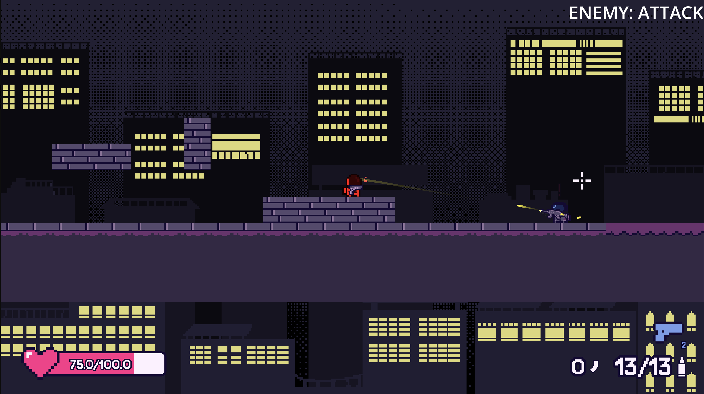
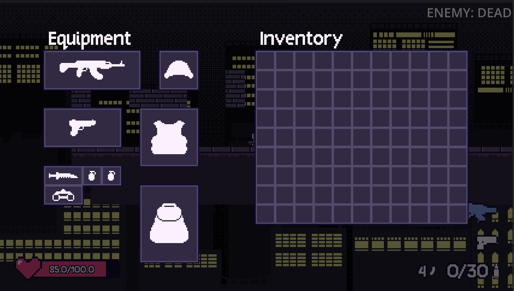

### ABOUT THIS PROJECT
This is a 2D platformer shooter game developed using Godot 4.7 and GDScript. Still work in progress.

Still working on the story :P (I'm getting the main mechanics done though)

### WHY DID I MAKE THIS?
Why not?

Seriously though, I just like game dev and I like making games in Godot :D

### STATE OF DEVELOPMENT
Currently shooting, movement, stamina, inventory (partially) and enemies (partially) is finished.
There is a dev room where you can try out the movement and shooting mechanics.

To see the changelog, see CHANGELOG.md

### HOW TO RUN/PLAY
Head over to https://kyteidev.itch.io/rogueshot-itchio and click play!

CONTROLS:

- WASD/Arrow keys: move and jump
- Space: jump
- Left mouse button: shoot
- Z: facing lock (player direction follows movement instead of cursor)
- R: reload
- Q: cycle weapon
  - 1: Equip Primary
  - 2: Equip Secondary
- E: open inventory
  - R: rotate item (in inventory)

### SCREENSHOTS

### THIRD PARTY ASSETS
- Groundhog font by ChevyRay - https://chevyray.itch.io/pixel-font-groundhog
- minibyte font by WQON - https://wqonart.itch.io/minibyte
- Deckhand font by Pixel Rascal - https://pixelrascal.itch.io/font-deckhand
- Cyberpunk Tileset - 16X16 by MORDA - https://morda-studios.itch.io/cyberpunk-tileset-16x16?download
- Simple circle transition shader by agurkas - https://godotshaders.com/shader/simple-circle-transition-2/ - has been modified
- 2D outline shader by Julian-Vos - https://godotengine.org/asset-library/asset/2829 - MIT license found in shaders/outline.gdshader
- Weapon SFX collection (multiple authors) - https://hamsunqiu.itch.io/modern-military-weapons-sound-pack-38-wav-cc0
- Brackeys Platformer Assets (sounds) by Brackeys, Asbjørn Thirslund - https://brackeysgames.itch.io/brackeys-platformer-bundle
- Bullet Casing On Concrete 2.wav by CodyGudmundsen - https://freesound.org/s/179005/ - License: Attribution 4.0
- Latch Clicking.wav by nicklas3799 - https://freesound.org/s/467359/ - License: Attribution 4.0

### CREDITS
- Celeste for inspiring me to add the wallbounce mechanic
- Road to Vostok for inspiring me to implement weapon stamina
- The Legends of Zelda: Breath of the Wild for inspiring me to add a tiered player detection for enemies
